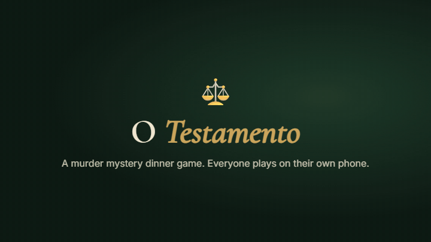

🇬🇧 **English** · 🇵🇹 [Português](README.pt.md)

# O Testamento — a murder mystery for your phone

A **murder mystery** game to play over dinner with friends, each on their own phone.
A web app (PWA) built from scratch: nothing to install, no accounts, works on Android and iPhone.

This repository includes the sample case **"O Lobo de Prata"** (The Silver Wolf): eight heirs, an appraiser found dead
in the closet and a silver statue missing from the safe. One of you is the killer — and not even the host knows who.

▶ **Play now:** https://diogoguedes0305.github.io/o-testamento/

<p align="center"></p>
<p align="center"><sub>🎬 Animated demo · from the invitation to the verdict</sub></p>

> The game itself is in Portuguese.

## How to play

- **6 to 8 players**, each with their own phone. One of them is the **host** (who also plays).
- Each player gets a **secret code** that unlocks their **character sheet**: who they are, where they were,
  what they saw, their link to the victim and a secret.
- You may lie about yourself, **never** about what you saw. Never show your sheet to anyone.
- Dinner has **3 rounds** (starter, main course, dessert). In each one the host reveals new evidence,
  which appears on every phone at the same time.
- At the end everyone votes for the killer and tries to guess the others' secrets.
- Then come the killer reveal, an animated **reconstruction** on the floor plan, the solution and the **podium**.

### Points
- +3 for each innocent who names the killer.
- +1 for each secret guessed (the secret's owner confirms it).
- The killer gets +1 for each person who didn't vote for them, and +2 if the person they framed gets the most votes.

## Try it with friends

1. The host opens the link. The app creates a **room** just for you and the address gets `?sala=XXXXX`.
2. The host types their code (**TINTEIRO**) and taps **Salvar** and **Entrar**.
3. **Tap the title 5 times quickly** to open the **host guide** (only on the host's phone).
   Under "Códigos dos jogadores", **Copiar** prepares a message with the code and the room link for each friend.
4. The host reads the story out loud and uses the guide button to move on:
   round 1 → 2 → 3 → open the vote → reveal the killer → solution → podium.

> To test alone, open the same room in several tabs or private windows, each with a different code.
> Each code can only be on one phone at a time.

| Player | Code |
|---|---|
| Rui (host) | TINTEIRO |
| Inês | CAMELIA |
| Tiago | ESTRIBO |
| Beatriz | MONOCULO |
| Hugo | CHARUTO |
| Marta | PERGAMINHO |
| Nuno | CRISTAL |
| Filipe | GALGO |

## What's in the app

- Personal **character sheet**, behind a curtain ("Só para os teus olhos" — for your eyes only).
- **Evidence** for each round, with marks on the **floor plan** where each item was found.
- **Detective notebook**: the floor plan, a board with where everyone was at the time of the crime, notes,
  and a **timeline** in 5-minute steps. It stays on your phone only.
- **Family**: portraits of everyone in gold oval frames.
- **Voting** in three phases (vote, confirm guesses, reveal), synced between phones.
- **Reconstruction**: the killer's path animated on the floor plan, minute by minute.
- Works offline after the first visit (service worker) and can be added to the home screen.

## How it works

- `site/` — the app: plain HTML, CSS and JavaScript, no build step and no dependencies.
- Each case's secrets are **encrypted** (AES-GCM, with a PBKDF2 key derived from each code):
  `site/dados/<case>/caso.json`. Each code only unlocks its own part. Public data is in `publico.json`.
- Syncing between phones (rounds, presence, votes) uses a Firebase Realtime Database over REST.
  This demo uses the `testamento-demo/<room>` folder.

### Run it locally

```bash
node ferramentas/servir.mjs        # opens http://localhost:8080
```
Browser encryption only works on `localhost` or `https`.

### Write your own case

> ⚠️ **Spoiler:** `casos/ensaio.json` is the sample case in plain text, with the solution. Don't open it if you want to play.

1. Copy `casos/ensaio.json` and write your story: players, sheets, rounds (with `marcas` on the floor plan),
   solution (with the killer's `percurso`) and guide.
2. `node ferramentas/cifrar.mjs casos/my-case.json --padrao` generates `site/dados/<id>/` and printable envelopes
   in `privado/` (outside the site).
3. `node ferramentas/testar-dados.mjs site/dados/<id> casos/my-case.json` checks that everything opens with the right codes.
4. For your own night, replace the database address in `site/app.js` (the `BD` constant) with your own
   Firebase Realtime Database.

The floor plan is drawn in SVG in `site/app.js` (`SALAS`); adapt it to your home.

---
Made with the help of Claude, for a game night at home.
The names and characters in this sample case are fictional.
